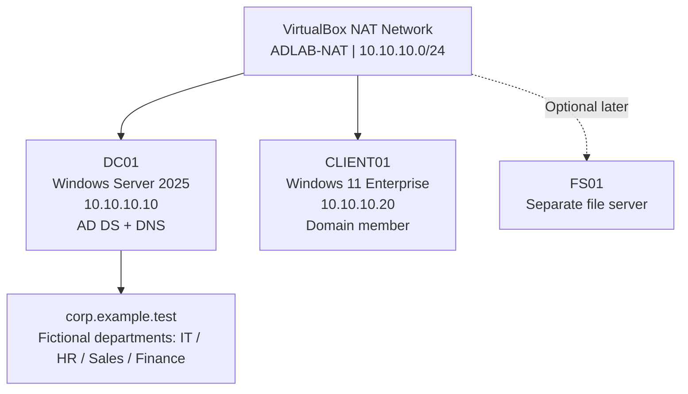

# Enterprise Active Directory Home Lab

> **Status: In progress — no lab configuration has been verified yet.**  
> **Type:** Personal learning project / simulated small-business IT environment  
> **Host:** Windows PC with 16 GB DDR4 RAM

## Project objective

Build and document a realistic Windows-based enterprise domain in VirtualBox. This hands-on lab will cover Active Directory Domain Services (AD DS), DNS, domain joining, organizational units (OUs), user and group management, Group Policy, file permissions, PowerShell automation, and troubleshooting.

This is a **fictional company in a local virtual lab**, not a real business deployment. The checkboxes and validation log will be updated only after each step is performed and tested.

## Planned network topology

**Important:** The NAT gateway is *expected* to be 10.10.10.1 for this network, but we will verify it in VirtualBox before configuring static addresses. DHCP will be disabled for this lab NAT network. Both VMs must use the **same NAT Network**, not separate default NAT adapters. Do not configure inbound port-forwarding to the domain controller.

## VM specifications (planned)

| Machine | OS | RAM | vCPUs | Disk | Lab IPv4 |
|---|---|---:|---:|---:|---|
| DC01 | Windows Server 2025 Standard Evaluation, Desktop Experience | 3 GB | 2 | 60 GB dynamic | 10.10.10.10 |
| CLIENT01 | Windows 11 Enterprise Evaluation | 4 GB | 2 | 64 GB dynamic | 10.10.10.20 |

Windows 11's VM must meet the installer requirements, including EFI and virtual TPM 2.0. Only run the virtual machines needed for the current step to keep the 16 GB host responsive. Ideally keep 100 GB or more of available disk space for updates and virtual disks.

## Milestone tracker

- [ ] 1. Enable hardware virtualization and install VirtualBox
- [ ] 2. Download evaluation ISOs and create ADLAB-NAT network
- [ ] 3. Build and install DC01
- [ ] 4. Configure static IP, AD DS, DNS, and forest `corp.example.test`
- [ ] 5. Build CLIENT01 and join it to the domain
- [ ] 6. Create department OUs, users, and groups
- [ ] 7. Create and verify a Group Policy Object (GPO)
- [ ] 8. Build and test department share permissions
- [ ] 9. Automate test-user onboarding/offboarding with PowerShell
- [ ] 10. Reproduce, diagnose, and fix a lab failure; publish evidence

## Project documentation

- [Step-by-step build guide](docs/01-build-guide.md)
- [Testing and validation checklist](docs/02-validation.md)
- [Troubleshooting journal](docs/03-troubleshooting.md)
- [Network diagram and IP plan](docs/04-network-diagram.md)
- [Screenshot evidence plan](screenshots/README.md)
- [PowerShell automation plans](scripts/README.md)

## Lessons learned

*To be added after successful hands-on milestones.*

## Security and privacy

Use fictional names and identities only. Never upload passwords, DSRM recovery credentials, SSH/API keys, evaluation ISO files, virtual disks, personal email addresses, or other sensitive information. Redact screenshots before posting.

## Reference material

- [Oracle VirtualBox downloads](https://www.virtualbox.org/wiki/Downloads)
- [Oracle VirtualBox 7.2 networking](https://docs.oracle.com/en/virtualization/virtualbox/7.2/user/networkingdetails.html)
- [Microsoft Windows Server evaluation](https://www.microsoft.com/en-us/evalcenter/download-windows-server-2025)
- [Microsoft Windows 11 Enterprise evaluation](https://www.microsoft.com/en-us/evalcenter/evaluate-windows-11-enterprise)
- [Microsoft guide: Install AD DS](https://learn.microsoft.com/en-us/windows-server/identity/ad-ds/deploy/install-active-directory-domain-services--level-100-)

## Resume use

Only list technologies and test results here **after completing the corresponding milestones**. This repo will provide evidence supporting future resume project bullet points.
