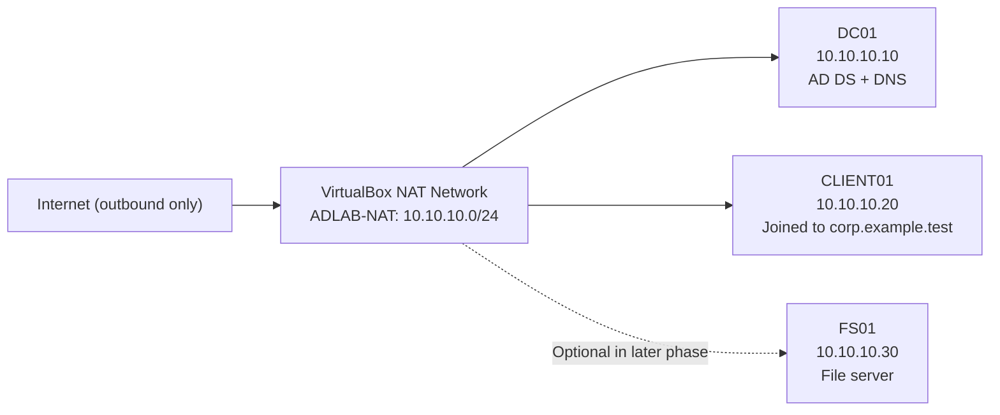

# Network topology and addressing

**Status:** Planned, not yet deployed.

| Component | Address / value | Notes |
|---|---|---|
| Virtual network | `ADLAB-NAT` / `10.10.10.0/24` | Same network chosen on both VMs |
| Gateway | `10.10.10.1` | **Verify** in NAT network settings |
| DC01 address | `10.10.10.10/24` | Static |
| DC01 preferred DNS | `10.10.10.10` | AD-integrated DNS (after promotion) |
| CLIENT01 address | `10.10.10.20/24` | Static |
| CLIENT01 DNS | `10.10.10.10` | Do **not** point the domain-joined client at public DNS |
| AD forest / domain | `corp.example.test` | Fictional domain |

**Isolation:** No inbound port-forwarding. Keep all AD lab hosts on the virtual NAT Network and do not bridge them directly to a production LAN. Before static configuration, verify gateway behavior and that no other network uses the chosen IP range.

**DNS note:** CLIENT01 must resolve the Active Directory DNS records from DC01 to discover and join the domain. Successful ping by IP alone does not prove Active Directory DNS is working.

**Resource note:** FS01 is optional and not part of the initial two-VM build on a 16 GB host. A shared folder can be simulated on DC01 for practice later, with the caveat that real deployments should use a separate file server.

**Evidence to add when tested:** VirtualBox NAT network screenshot; `ipconfig /all` on DC01 and CLIENT01; successful `nslookup corp.example.test 10.10.10.10`.
